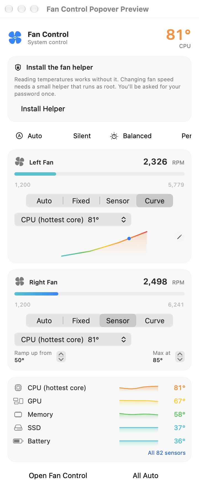
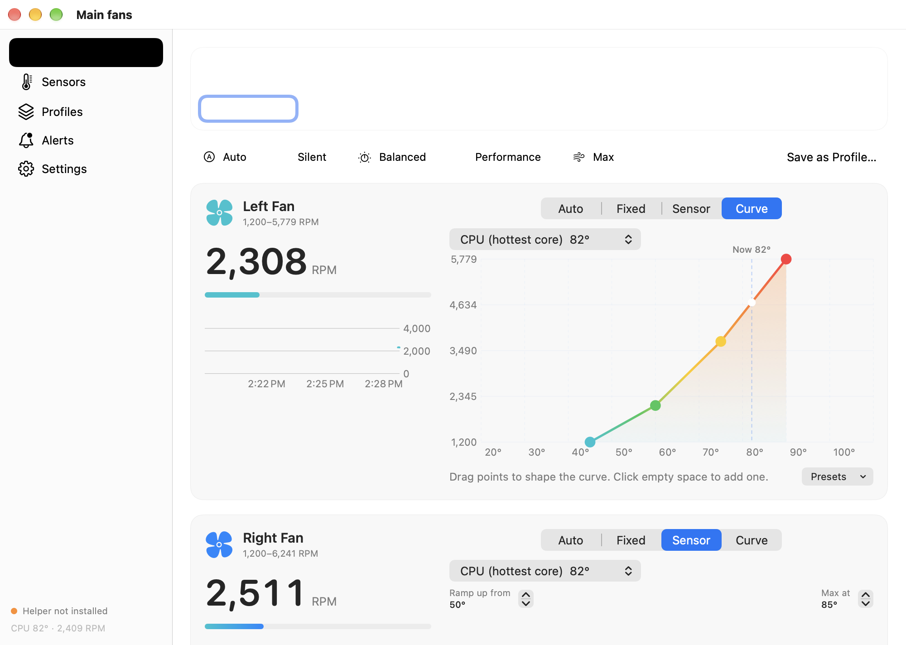

# Fan Control

A menu bar app for controlling your Mac's fans. It's a native SwiftUI replacement for Macs Fan Control.

<p>
  
  
</p>

## Features

- **Per-fan modes**:
  - **Auto**: macOS controls the fan.
  - **Fixed**: holds a constant RPM.
  - **Sensor**: speeds up linearly between two temperatures of any sensor.
  - **Curve**: follows a multi-point curve that you shape by dragging points in an editor.
- **Profiles**: Silent, Balanced, Performance and Max are built in, and you can create your own. Switch from the menu bar panel, by right-clicking the menu bar icon, or with **⌃⌥⌘F** (the profile name briefly appears in the menu bar).
- **Sensors**: CPU cores, GPU, memory, SSD, battery, palm rest, airflow and more, with live sparklines and 5 min to 24 h history charts. Pin your favourites to the menu.
- **Alerts**: a notification when a sensor goes over a threshold.
- **Menu bar item**: shows an icon, a temperature, fan speed, or both.
- Launch at login, °C or °F, and an adjustable update interval.
- **Lightweight**: under 1% CPU and about 30 MB of memory in the background. Nothing renders while the panel and window are closed, and the menu bar panel still opens instantly.
- **Safe by design**: fans go back to macOS control when the app quits, crashes, or stops responding for 10 seconds, and whenever the Mac sleeps.

## Requirements

- macOS 26 (Tahoe) or later. Tested on an M1 Max MacBook Pro running macOS 27. Other Apple Silicon Macs are supported (M3 and later use the `Ftst` unlock), and Intel Macs with SMC fan keys should work.
- Xcode 26 or later (from the App Store).
- [Homebrew](https://brew.sh), used to install `xcodegen`.

## Build and install

```sh
git clone https://github.com/crisjimenez120/fan-speed-control.git
cd fan-speed-control
brew install xcodegen
./scripts/build.sh
```

This builds a Release copy, installs it to `/Applications/Fan Control.app` and launches it. Look for the fan icon in the menu bar.

To update later:

```sh
git pull && ./scripts/build.sh
```

### First run: install the helper

Reading temperatures and fan speeds works right away. **Changing** fan speeds requires root, so Fan Control uses a small privileged helper.

1. Click the fan icon in the menu bar and pick any mode other than Auto (or go to **Settings → Install Helper**).
2. Click **Install Helper** and enter your password.

This only happens once, plus again after an update that changes the helper (the app will show an **Update** button). The helper is installed to `/Library/PrivilegedHelperTools/com.crisjimenez.FanControl.Helper` and runs as a LaunchDaemon. It can only set fan speeds, and every value it's given is clamped to the fan's own minimum and maximum.

### Code signing

`build.sh` signs the app with your **Apple Development** certificate if you have one. Any Apple ID gets one for free: open Xcode → Settings → Accounts, sign in, and click *Manage Certificates → +*. With a certificate, the helper only accepts connections from a Fan Control app signed by your team.

Without a certificate, the app is signed ad hoc. It still works, but the helper can then only check the app's bundle identifier. Your choice is saved in `Config/Local.xcconfig`. Delete that file to detect again.

### Building in Xcode instead

```sh
xcodegen generate
open FanControl.xcodeproj
```

Run the **FanControl** scheme. Run `./scripts/build.sh --no-install` once first if you want it to set up signing for you.

## Uninstall

1. In **Settings**, click **Uninstall Helper**. This returns the fans to automatic control and removes the daemon.
2. Quit the app and delete `/Applications/Fan Control.app`.
3. Optionally, remove your settings: `rm -rf ~/Library/Application\ Support/FanControl`.

## Tips

- **⌃⌥⌘F** cycles through profiles. You can turn this off in Settings.
- To apply a profile at launch, for example from a script, run: `open -a "Fan Control" --args -FCProfile Silent`
- Fan curves are shared between fans as percentages of each fan's range, so one curve suits fans with different maximum speeds.
- If a curve's sensor disappears, that fan runs at full speed rather than guessing.

## Development

```
App/                 SwiftUI menu bar app (model, XPC client, views)
Helper/              Privileged helper daemon (XPC service, watchdog)
Packages/FanKit/
  CSMC               C bridge to AppleSMC and the HID temperature sensors
  SMCKit             SMC reads and writes, fan and sensor discovery
  FanCore            Modes, curves, the fan controller, history, alerts (unit tested)
  FanShared          XPC protocol shared by the app and the helper
  smcprobe           Command-line tool that prints your Mac's fans and sensors
```

```sh
cd Packages/FanKit
swift test          # run the unit tests
swift run smcprobe  # list the fans and sensors on this Mac
```

## Disclaimer

Running fans too slowly can let your Mac get hot. macOS still throttles and shuts down to protect the hardware, but use low-speed curves with care. You use this software at your own risk.
